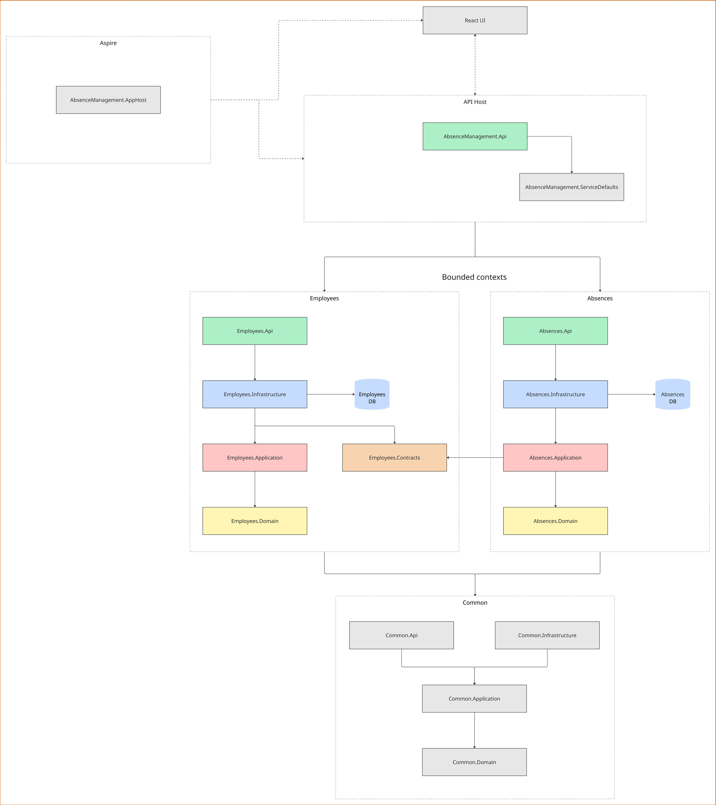

# Absence Management

A web application to create and manage absences of employees.

Employees file absence requests, approvers decide them. The backend is a modular monolith in .NET
with a DDD-oriented layering per bounded context using Clean Architecture. The frontend is an Nx
workspace with two React applications, `web` for employees and `admin` for approvers. .NET Aspire
starts everything: database, API and both dev servers.

| Part      | Stack                                                                    |
| --------- | ------------------------------------------------------------------------ |
| Backend   | .NET 10, ASP.NET Core Minimal APIs, EF Core, PostgreSQL                  |
| Frontend  | React 19, Vite 8, Mantine, TanStack Query, TypeScript                    |
| Local run | .NET Aspire (PostgreSQL in a container, dashboard with logs and traces)  |
| Toolchain | mise (installs the .NET SDK, Node 26 and pnpm in the pinned versions)    |

## Layout

```text
src/                the backend
src/Common/         building blocks every bounded context reuses
src/Contexts/       one folder per bounded context, four projects each
src/Hosts/          the web host that mounts the bounded contexts
tests/              tests for the backend
tests/Common/       tests for the building blocks, e.g. the dispatch of domain events
tests/Contexts/     one test project per bounded context
tests/Architecture/ rules that hold across all contexts, checked with ArchUnitNET
aspire/             the AppHost: which resources run and how they depend on each other
frontend/           the frontend built as Nx workspace, apps and packages
```

## Getting started

Two prerequisites: [mise](https://mise.jdx.dev) and a container runtime (Docker Desktop or Podman).
mise installs the .NET SDK, Node and pnpm in the versions this repository pins, see
[Tool versions](#tool-versions), and puts them on the `PATH` inside the repository, without
touching the toolchain of any other project.

**1. Install mise:**

```bash
# Windows
winget install jdx.mise

# macOS
brew install mise

# Linux
curl -fsSL https://mise.run | sh
```

The alternatives and the details per operating system are in
[docs/COMMANDS.md](docs/COMMANDS.md#install-mise).

**2. Activate it in the shell**, so that entering the repository switches the versions. Add the
line for the shell to its profile and open a new shell:

```bash
# PowerShell, in $PROFILE
(&mise activate pwsh) | Out-String | Invoke-Expression

# zsh, in ~/.zshrc
eval "$(mise activate zsh)"

# bash, in ~/.bashrc
eval "$(mise activate bash)"
```

On Windows, PowerShell 7 and Windows PowerShell 5.1 each read their own `$PROFILE`, so the line goes
into every one you use, see [docs/COMMANDS.md](docs/COMMANDS.md#activate-mise-in-the-shell).

**3. Install the tools**, from the repository root:

```bash
mise trust
mise install
```

`mise trust` confirms this repository's `mise.toml` once, `mise install` downloads the .NET SDK,
Node and pnpm. `dotnet --version`, `node --version` and `pnpm --version` then report the pinned
versions.

**4. Run the application:**

```bash
dotnet run --project aspire/AbsenceManagement.AppHost
```

Aspire takes care of the rest: it starts the PostgreSQL container, hands each bounded context its
connection string, runs `pnpm install`, regenerates the API client, and only then brings up the
two dev servers.

The Aspire dashboard opens at <http://localhost:15246> and lists every resource with its URL: the
API (interactive docs under `/scalar/v1`), the two frontends, PostgreSQL and pgAdmin. The ports of
the applications are assigned per run, so look them up in the dashboard.

With the optional Aspire CLI (`dotnet tool install --global Aspire.Cli`) the same thing works from
anywhere in the repository:

```bash
aspire run
```

## Tool versions

mise installs the toolchain, but no version is written down twice. Each one has exactly one place:

| Tool     | Version declared in                        |
| -------- | ------------------------------------------ |
| .NET SDK | [global.json](global.json) → `sdk.version` |
| Node     | [mise.toml](mise.toml) → `node`            |
| pnpm     | [mise.toml](mise.toml) → `pnpm`            |

`global.json` is the file the dotnet CLI, MSBuild and the IDEs read anyway, so mise reads the SDK
version from there instead of repeating it. Node and pnpm are requested by major version, and
`mise.lock` records the exact versions and checksums they resolved to. Local machines and
[CI](.github/workflows/ci.yml) install from the same lockfile.

Rider and WebStorm pick the versions up through the mise plugin, VS Code through the mise
extension, see [docs/COMMANDS.md](docs/COMMANDS.md#ide-integration).

## Tests and checks

```bash
dotnet test
```

```bash
cd frontend && pnpm test && pnpm check
```

`pnpm check` runs type checking, oxlint (including Nx's architecture boundary rule), and the
formatting check.

## Business rules

- A request needs an employee, an absence type and a valid date range, and starts as `Open`.
- Requests for the same employee may not overlap.
- Only open requests may be edited, approved or rejected. A decision is final.

## Known limitations

- There is no authentication or authorization. The employee and admin apps represent the two roles.
- Public holidays, partial days, notifications and multi-stage approvals are not supported.
- Concurrent updates are not protected by optimistic concurrency control.
- Domain events are handled inside the transaction of the change that raised them. A reaction in
  another bounded context or outside the database, such as an e-mail, would need an outbox, which
  does not exist yet.

## Documentation

- [docs/COMMANDS.md](docs/COMMANDS.md) — the cheat sheet: useful commands that come up while
  working on this repository
- [docs/TASK.md](docs/TASK.md) — the original task description
- [docs/BOOTSTRAP.md](docs/BOOTSTRAP.md) — how this repository was built, step by step, and why
- [AGENTS.md](AGENTS.md) — rules, instructions, and context provided for coding agents (and
  humans) for interacting with the codebase of this repository.

## Architectural overview

The Aspire AppHost (orchestrator) starts the API web host, which mounts one bounded context per
domain boundary, and the React applications talk to the API over HTTP. Inside a bounded context the
dependencies point inwards, from `Api` over `Infrastructure` and `Application` to `Domain`, and
every one of them owns its database. They never reference each other directly: `Absences` depends
on the `Contracts` project of `Employees`. `Common` holds the building blocks all of them reuse.
Every change of an aggregate raises a domain event, and handlers in the same bounded context react
to it before the change is committed, in the same transaction.


